# Venta Online: Comentarios sobre productos y Valoración de Vendedores

**Marcos de Desarrollo – Curso 2026/2027 – Grupo mad08 (Trustify)**

| Miembro | Login UDC | Parte |
|---|---|---|
| Martín Hernández González | m.hernadezg@udc.es | Usuarios (registro, autenticación, perfil) + OAuth |
| Nicolás Figueroa Lago | [login] | Productos, categorías y valoraciones + caché de búsquedas |
| Maicol Lois Lugo | m.lois.lugo@udc.es | Comentarios y denuncias + etiquetado |

<!--
NOTAS PARA NOSOTROS (borrar antes de imprimir)
- Enunciado §6.3: documento BREVE pero CLARO. Diagramas en UML, de calidad,
  explicados, y NO hechos por ingeniería inversa.
- Se entrega IMPRESA en la defensa de la iteración 2 (si no, -0,5 puntos).
- Iteración 1: solo hay que enseñar los diagramas del apartado 2 en una herramienta UML.
- Leyenda: [ ] pendiente · [~] en curso · [x] hecho
-->

---

## 1. Arquitectura global

<!-- [ ] Responsable: A
Qué pide: estructura global de paquetes (no hace falta UML). Solo los paquetes de
más alto nivel y sus subpaquetes principales, y qué contiene cada uno. -->

La aplicación es una solución de Visual Studio (`MAD-Template.sln`, .NET Framework 4.8) dividida en tres proyectos más una librería externa. Seguimos una arquitectura en capas: la capa web solo accede a la capa modelo a través de las interfaces de los servicios, y los servicios solo acceden a la base de datos a través de los DAOs.

```
MAD-Template.sln
├── Lib/ModelUtil.dll                  (librería proporcionada por los profesores)
├── Model   (Es.Udc.DotNet.Trustify.Model)                         -> capa modelo
│   ├── Trustify.Model.edmx (+ .tt)    entidades persistentes y TrustifyEntities (DbContext)
│   ├── XxxDao                          un paquete por entidad: IXxxDao + XxxDaoEntityFramework
│   │     (UserProfileDao, OAuthAccountDao, CategoryDao, ProductDao, RatingDao,
│   │      CommentDao, CommentReportDao, TagDao)
│   ├── XxxService                      un paquete por servicio: IXxxService + XxxService
│   │   ├── (raíz)                      DTOs (UserProfileDetails, LoginResult, CommentDetails, TagDetails)
│   │   ├── Exceptions                  excepciones propias del servicio
│   │   └── Util                        utilidades (PasswordEncrypter, TagNames)
│   │     (UserService, CategoryService, ProductService, RatingService,
│   │      CommentService, TagService)
│   └── SQL                             SqlServerCreateDatabase.sql, SqlServerCreateTables.sql
├── Test    (Es.Udc.DotNet.Trustify.Test)                          -> pruebas de integración
│   ├── TestManager                     configuración del kernel de Ninject para las pruebas
│   ├── XxxDao / XxxService             clases de prueba MSTest (IXxxDaoTest, IXxxServiceTest)
│   └── Scripts                         SqlServerCreateTables.Test.sql (BD Trustify_test)
└── Web     (Es.Udc.DotNet.Trustify.Web)                           -> capa web (ASP.NET WebForms)
    └── HTTP
        ├── Session                     SessionManager, UserSession, SpecificCulturePage
        ├── Util                        CookiesManager
        │   └── IoC                     IoCManagerNinject (bindings de DAOs, servicios y DbContext)
        └── View/ApplicationObjects     Countries, Languages, Locale (datos para la vista)
```

- **Lib/ModelUtil**: código común reutilizado de los ejemplos de la asignatura: `IGenericDao<E, PK>` y `GenericDaoEntityFramework<E, PK>`, las excepciones `InstanceException`, `InstanceNotFoundException` y `DuplicateInstanceException`, el atributo `[Transactional]` y la interfaz `IIoCManager`.
- **Model**: entidades generadas por Entity Framework 6 (Database First) a partir del EDMX, los DAOs y los servicios con sus DTOs, excepciones y utilidades. Agrupamos los ficheros por entidad (un paquete por DAO y uno por servicio), igual que en los ejemplos de la asignatura.
- **Test**: pruebas de integración de DAOs y servicios contra una base de datos de pruebas (`Trustify_test`).
- **Web**: aplicación WebForms. En esta iteración solo contiene la infraestructura (gestión de sesión, cookies, internacionalización e IoC); las páginas se desarrollan en la iteración 2.

---

## 2. Modelo

### 2.1 Clases persistentes

<!-- [ ] Responsable: A
Qué pide: TODAS las clases persistentes en uno o varios diagramas de clases, con
sus relaciones relevantes.
Clases: UserProfile, Category, Product, Comment, CommentReport, Rating, Tag
(+ la relación N:M CommentTag). -->

`[Diagrama 2.1 – Clases persistentes]`

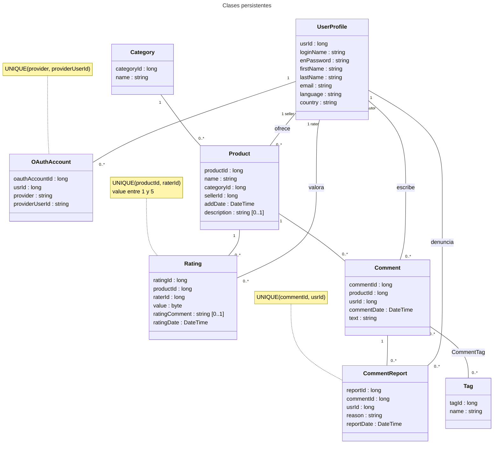

Todas las clases persistentes se generan con Entity Framework a partir del modelo `Trustify.Model.edmx`, cuyas tablas se definen en `SqlServerCreateTables.sql`. Las decisiones principales son:

- **UserProfile** representa a cualquier usuario. No distinguimos entre comprador y vendedor, porque el enunciado dice que un usuario puede ejercer ambos roles; el vendedor de un producto es el `UserProfile` referenciado por `Product.sellerId`.
- **Rating** no apunta directamente al vendedor, sino al producto sobre el que se valora (`productId`) y al usuario que valora (`raterId`). El vendedor valorado se obtiene a través de `Product.sellerId`, de modo que no hay información redundante. La restricción `UNIQUE(productId, raterId)` impide valorar dos veces al vendedor por el mismo producto.
- **CommentReport** guarda cada denuncia con su motivo. Con `UNIQUE(commentId, usrId)` un usuario solo puede denunciar una vez el mismo comentario. El estado "En revisión" **no se almacena**: se calcula a partir del número de denuncias (ver 2.5).
- **Tag** y la tabla intermedia **CommentTag** (parte opcional de etiquetado). Como `CommentTag` solo tiene las dos claves ajenas como clave primaria, Entity Framework la mapea como una relación N:M (`Comment.Tags` / `Tag.Comments`) y no genera una entidad propia.
- **OAuthAccount** (parte opcional de OAuth) relaciona un usuario con su cuenta en un proveedor externo (ver 4.3).
- El borrado de un comentario elimina en cascada sus denuncias y sus filas de `CommentTag` (`ON DELETE CASCADE`).

### 2.2 Interfaces de los servicios ofrecidos por el modelo

<!-- [ ] Responsable: cada uno el suyo
Qué pide: (1) el criterio para agrupar los casos de uso en servicios;
(2) un diagrama de clases POR SERVICIO con la interfaz (declaración completa de
las operaciones) y los tipos de datos que usan (DTOs, excepciones). -->

**Criterio de agrupación**

Hemos agrupado los casos de uso según la entidad principal sobre la que actúan, de forma que cada servicio tenga una responsabilidad clara y que cada miembro del grupo pudiese trabajar en servicios distintos sin conflictos:

- **IUserService**: todo lo relacionado con la cuenta del usuario: registro, autenticación (con contraseña o con OAuth), consulta y modificación del perfil y cambio de contraseña.
- **ICategoryService**: consulta de categorías (necesaria para buscar productos por categoría).
- **IProductService**: búsqueda de productos del catálogo (por palabra clave, categoría o vendedor). Contiene la caché de búsquedas.
- **IRatingService**: valorar a un vendedor y consultar sus valoraciones (número, media y listado paginado).
- **ICommentService**: comentarios de un producto (añadir, modificar, eliminar, listar) y sus denuncias. Las denuncias van en este servicio porque afectan directamente a los comentarios (un comentario "En revisión" no se puede modificar). La asignación de etiquetas a un comentario también está aquí, ya que se hace al crear o editar el comentario.
- **ITagService** (opcional): creación de etiquetas y consultas para la nube de etiquetas y las etiquetas de un producto.

En todos los servicios, las operaciones que devuelven listas paginadas reciben `startIndex` y `pageSize` y tienen una operación `CountXxx` asociada para que la capa web pueda calcular las páginas. Las excepciones genéricas `InstanceNotFoundException` y `DuplicateInstanceException` proceden de ModelUtil; las excepciones específicas de cada servicio están en su subpaquete `Exceptions`. Las operaciones devuelven entidades cuando no hace falta información adicional y DTOs (`XxxDetails`, `LoginResult`) cuando hay que combinar datos de varias entidades o no queremos exponer la entidad completa.

#### IUserService (A)

`[Diagrama – IUserService + UserProfileDetails, LoginResult, IncorrectPasswordException]`

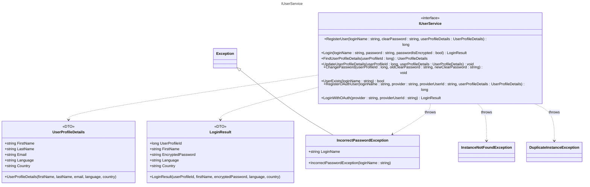

| Operación | Excepciones |
|---|---|
| `RegisterUser` | `DuplicateInstanceException` (login ya existe) |
| `Login` | `InstanceNotFoundException`, `IncorrectPasswordException` |
| `FindUserProfileDetails`, `UpdateUserProfileDetails` | `InstanceNotFoundException` |
| `ChangePassword` | `InstanceNotFoundException`, `IncorrectPasswordException` |
| `RegisterOAuthUser` | `DuplicateInstanceException` (login o cuenta OAuth ya existentes) |
| `LoginWithOAuth` | `InstanceNotFoundException` (no hay usuario vinculado a esa cuenta) |

`LoginResult` contiene lo que la capa web necesita guardar en la sesión tras autenticarse. Incluye la contraseña cifrada para implementar "recordar contraseña": la web la guarda en una cookie y en el siguiente acceso llama a `Login` con `passwordIsEncrypted = true`.

#### ICategoryService (B)

`[Diagrama – ICategoryService]`

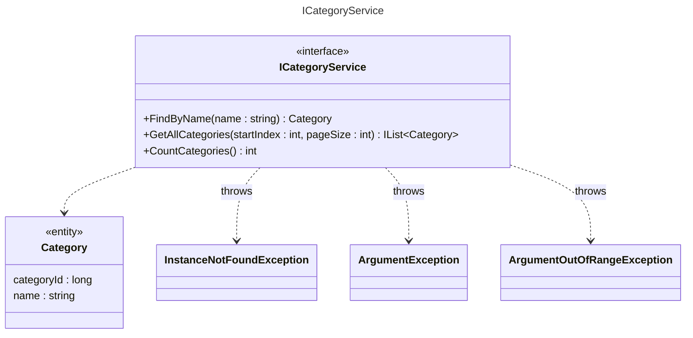

`FindByName` lanza `ArgumentException` si el nombre está vacío e `InstanceNotFoundException` si la categoría no existe. `GetAllCategories` devuelve las categorías ordenadas por nombre y lanza `ArgumentOutOfRangeException` si `startIndex` o `pageSize` son negativos.

#### IProductService (B)

`[Diagrama – IProductService]`

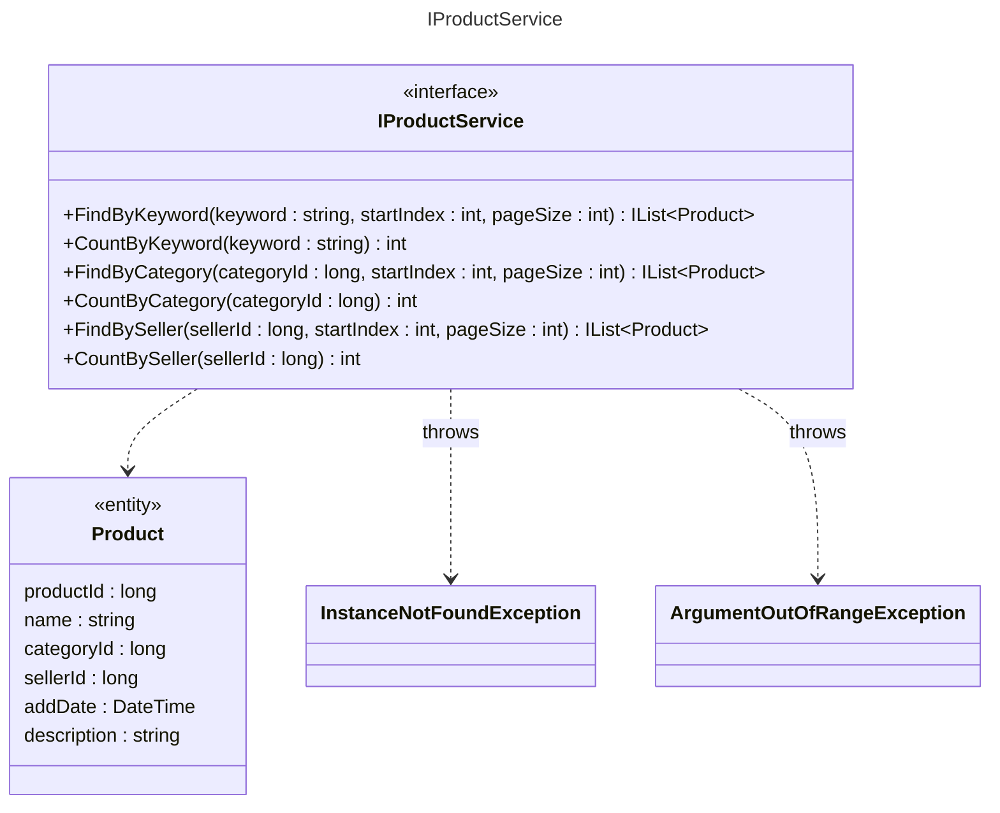

La búsqueda por palabra clave no distingue mayúsculas de minúsculas y busca la palabra dentro del nombre del producto; si la palabra está vacía devuelve una lista vacía. `FindByCategory` y `CountByCategory` lanzan `InstanceNotFoundException` si la categoría no existe. Las operaciones `FindXxx` lanzan `ArgumentOutOfRangeException` con índices negativos. Devolvemos la entidad `Product`, ya que desde ella la web puede acceder a `Category.name` y al `loginName` del vendedor (`UserProfile`) mediante las propiedades de navegación.

#### IRatingService (B)

`[Diagrama – IRatingService + SelfRatingException]`

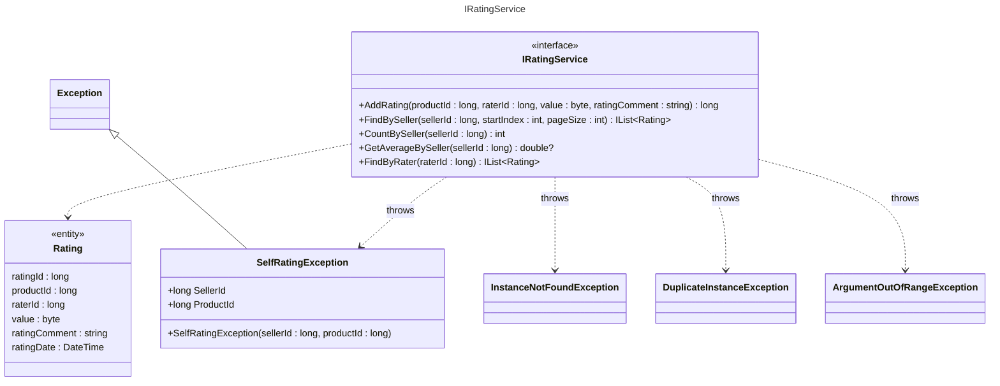

`AddRating` lanza `ArgumentOutOfRangeException` si el valor no está entre 1 y 5, `InstanceNotFoundException` si el producto no existe, `SelfRatingException` si el usuario intenta valorarse a sí mismo (es el vendedor del producto) y `DuplicateInstanceException` si ya había valorado al vendedor por ese producto. `GetAverageBySeller` devuelve `null` si el vendedor no tiene valoraciones. `FindBySeller` devuelve las valoraciones de más reciente a más antigua.

#### ICommentService (C)

`[Diagrama – ICommentService + CommentDetails, CommentPermissionException, CommentUnderReviewException]`

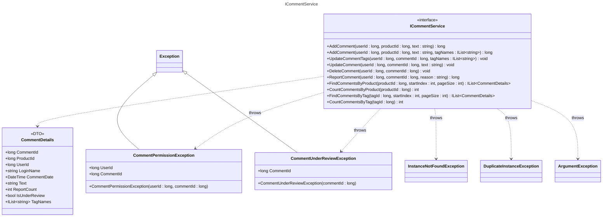

| Operación | Excepciones |
|---|---|
| `AddComment` (ambas) | `InstanceNotFoundException` (usuario o producto), `ArgumentException` (texto vacío o > 1000 caracteres, etiqueta no válida) |
| `UpdateComment`, `UpdateCommentTags` | `InstanceNotFoundException`, `ArgumentException`, `CommentPermissionException` (no es el autor), `CommentUnderReviewException` (comentario "En revisión") |
| `DeleteComment` | `InstanceNotFoundException`, `CommentPermissionException` |
| `ReportComment` | `InstanceNotFoundException`, `ArgumentException` (motivo vacío o > 500 caracteres), `DuplicateInstanceException` (ya lo había denunciado) |
| `FindCommentsByProduct`, `FindCommentsByTag` | `InstanceNotFoundException`, `ArgumentOutOfRangeException` |
| `CountCommentsByProduct`, `CountCommentsByTag` | `InstanceNotFoundException` |

`CommentDetails` reúne en un único objeto lo que la página de comentarios necesita mostrar: el login del autor, el número de denuncias, si está "En revisión" y sus etiquetas. Los comentarios se devuelven ordenados por fecha descendente.

#### ITagService (C, parte opcional)

`[Diagrama – ITagService + TagDetails]`

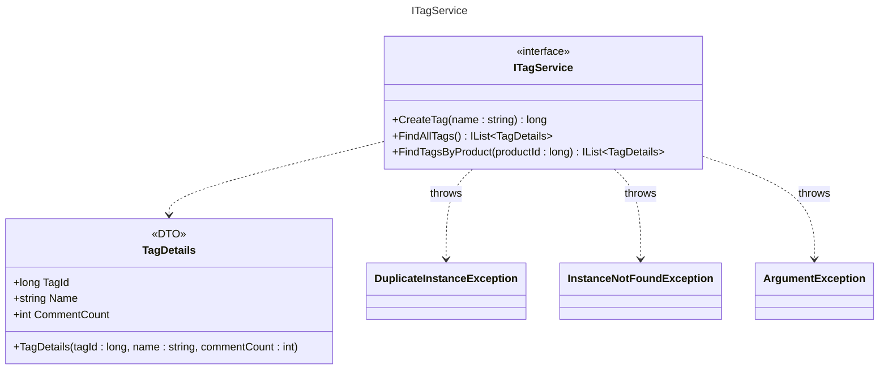

`CreateTag` lanza `ArgumentException` si el nombre está vacío o tiene más de 30 caracteres y `DuplicateInstanceException` si la etiqueta ya existe. `FindTagsByProduct` lanza `InstanceNotFoundException` si el producto no existe. `TagDetails.CommentCount` sirve para calcular el tamaño de cada etiqueta en la nube.

### 2.3 Diseño de un DAO

<!-- [ ] Responsable: A
Qué pide: diagrama(s) de clases con la implementación de UN DAO (el resto es igual).
Propuesta: IUserProfileDao / UserProfileDaoEntityFramework, que heredan de
IGenericDao<E, PK> / GenericDaoEntityFramework<E, PK> (ModelUtil). -->

`[Diagrama 2.3 – UserProfileDao]`

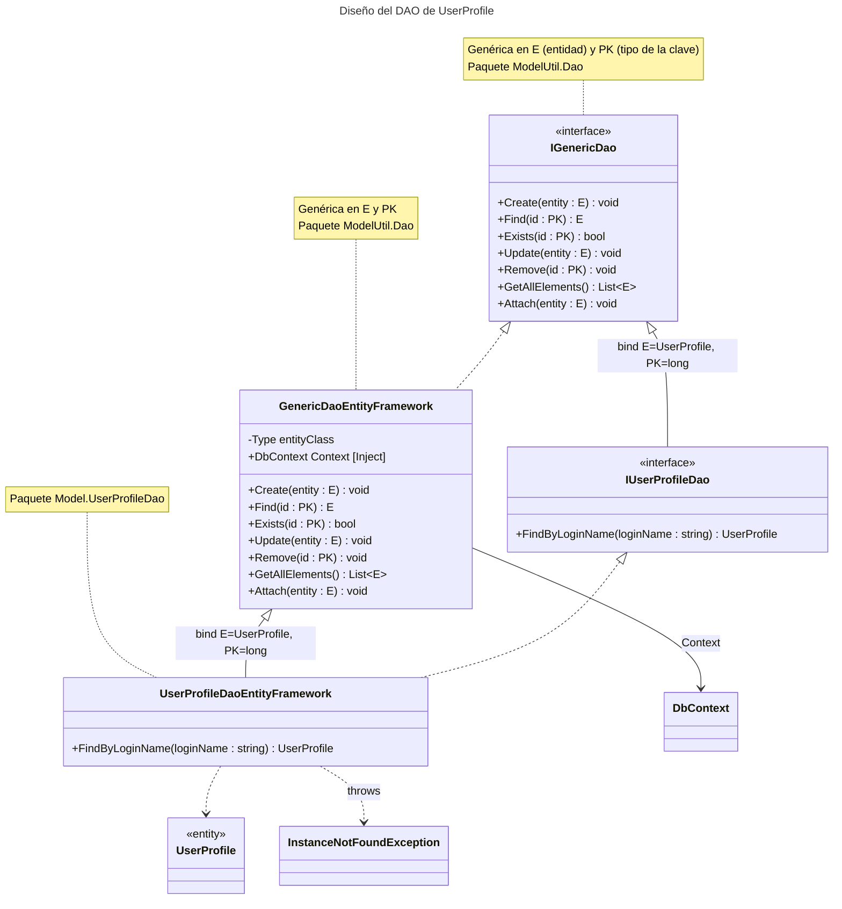

Todos los DAOs siguen el mismo esquema, basado en el DAO genérico de ModelUtil:

- `IGenericDao<E, PK>` declara las operaciones CRUD comunes a cualquier entidad y `GenericDaoEntityFramework<E, PK>` las implementa una sola vez con Entity Framework, usando el `DbContext` que recibe por inyección de dependencias (propiedad `Context`). `Find` y `Remove` lanzan `InstanceNotFoundException` si no existe la entidad.
- `IUserProfileDao` extiende la interfaz genérica fijando `E = UserProfile` y `PK = long` y añade solo las operaciones específicas, en este caso `FindByLoginName`.
- `UserProfileDaoEntityFramework` hereda la implementación genérica e implementa la operación específica con una consulta LINQ sobre `Context.Set<UserProfile>()`. Si no hay ningún usuario con ese login lanza `InstanceNotFoundException`.

De este modo cada DAO concreto solo contiene sus consultas propias (búsquedas, conteos, paginación con `Skip`/`Take`), y los servicios dependen únicamente de la interfaz, por lo que la implementación con Entity Framework se puede sustituir sin cambiar los servicios.

### 2.4 Diseño de un servicio del modelo

<!-- [ ] Responsable: A
Qué pide: (1) diagrama(s) de clases con la implementación de UN servicio;
(2) un diagrama de SECUENCIA de un caso de uso en la capa modelo.
Propuesta: UserService (+ IUserProfileDao, PasswordEncrypter, DTOs) y la secuencia de Login. -->

`[Diagrama 2.4a – Clases de UserService]`

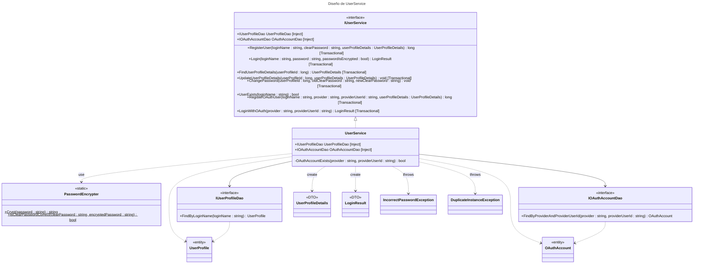

`UserService` implementa `IUserService` y depende únicamente de las interfaces de los DAOs (`IUserProfileDao` e `IOAuthAccountDao`), que Ninject le inyecta en las propiedades marcadas con `[Inject]`. Las operaciones marcadas con `[Transactional]` se ejecutan dentro de una transacción (ver 2.5). El cifrado de contraseñas se delega en la clase de utilidad `PasswordEncrypter`, para que el servicio nunca compare ni guarde contraseñas en claro. Hacia la capa web solo salen DTOs (`UserProfileDetails`, `LoginResult`), nunca la entidad `UserProfile`, y así la contraseña cifrada solo se expone en `LoginResult` para "recordar contraseña".

`[Diagrama 2.4b – Secuencia de Login]`

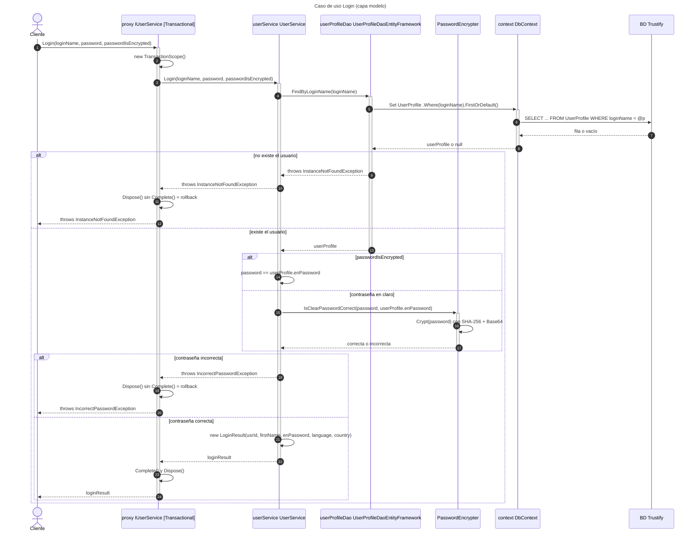

El cliente (la capa web o una prueba) obtiene el servicio a través de Ninject, que en realidad le devuelve un proxy. Al invocar `Login`, el proxy abre una transacción porque el método está marcado con `[Transactional]` y delega en `UserService`. El servicio busca el usuario por su login a través del DAO, que consulta la base de datos mediante el `DbContext`. Pueden ocurrir dos errores:

1. Si no existe ningún usuario con ese login, el DAO lanza `InstanceNotFoundException`, que llega al cliente sin modificar.
2. Si el usuario existe pero la contraseña no coincide, el servicio lanza `IncorrectPasswordException`. Si la contraseña llega cifrada (cookie de "recordar contraseña") se compara directamente con la almacenada; si llega en claro, se cifra con `PasswordEncrypter` y se comparan los resúmenes.

En ambos casos el proxy cierra la transacción sin confirmarla. Si todo va bien, el servicio construye un `LoginResult` y el proxy confirma la transacción antes de devolverlo.

### 2.5 Otros aspectos

<!-- [ ] Opcional: aspectos relevantes de la capa modelo.
Ideas: [Transactional] e inyección con Ninject, plantilla .tt del profesor
(Equals/GetHashCode), cálculo de "En revisión" (3 denuncias), cifrado de
contraseñas (SHA-256), estrategia de los tests (TransactionScope + rollback). -->

- **Inyección de dependencias con Ninject.** Los servicios y DAOs no crean sus dependencias: las declaran como propiedades con `[Inject]` (inyección por propiedad) y Ninject las resuelve a partir de los *bindings* interfaz → implementación, definidos en `IoCManagerNinject` (web) y `TestManager` (pruebas). El `DbContext` (`TrustifyEntities`) se registra con `InSingletonScope()` y se construye con la cadena de conexión `TrustifyEntities` del fichero de configuración, de modo que todos los DAOs comparten el mismo contexto y, por tanto, las mismas entidades cargadas.
- **Transacciones con `[Transactional]`.** El atributo de ModelUtil se basa en la extensión de interceptación de Ninject (`Ninject.Extensions.Interception.DynamicProxy`): Ninject genera un proxy dinámico del servicio que envuelve cada método marcado en un `TransactionScope`, lo confirma con `Complete()` si el método termina con éxito y lo deshace si lanza una excepción. Gracias a esto los servicios no contienen código de gestión de transacciones.
- **Plantilla T4 del profesor.** Las entidades se generan con `Trustify.Model.tt`, que además de las propiedades añade `Equals` (compara todas las propiedades escalares, incluida la clave), `GetHashCode`, `ToString` y los operadores `==` y `!=`. Esto nos permite comparar entidades directamente en los `Assert.AreEqual` de las pruebas. Los DTOs también redefinen `Equals`, `GetHashCode` y `ToString` por el mismo motivo.
- **Estado "En revisión" calculado.** No guardamos un atributo de estado en `Comment`: un comentario está "En revisión" cuando tiene 3 o más denuncias (`CommentService.ReportsForReview = 3`). `FindCommentsByProduct`/`FindCommentsByTag` lo calculan al construir `CommentDetails`, y `UpdateComment`/`UpdateCommentTags` lo comprueban con `CommentReportDao.CountByComment` antes de modificar, lanzando `CommentUnderReviewException`. Así el estado siempre es coherente con las denuncias y no hay datos redundantes. El borrado sigue permitido al autor.
- **Cifrado de contraseñas.** `PasswordEncrypter.Crypt` calcula el resumen SHA-256 de la contraseña (UTF-8) y lo codifica en Base64 (44 caracteres, cabe en `enPassword varchar(50)`). Solo se almacena el resumen; para comprobar una contraseña se cifra la introducida y se comparan los resúmenes.
- **Estrategia de las pruebas.** Las pruebas de integración (MSTest) se ejecutan contra la BD `Trustify_test`. Cada clase de prueba crea el kernel de Ninject con `TestManager.ConfigureNInjectKernel()` en `[ClassInitialize]` y obtiene los servicios del kernel, de modo que también se prueban los proxies transaccionales. En `[TestInitialize]` se abre un `TransactionScope` y en `[TestCleanup]` se llama a `Dispose()` sin `Complete()`, así que todos los cambios de cada prueba se deshacen y las pruebas son independientes entre sí y del orden de ejecución.

---

## 3. Interfaz gráfica

<!-- [ ] Iteración 2
Qué pide: diagrama de secuencia de un caso de uso representativo con las clases o
artefactos principales (página .aspx, code-behind, SessionManager, servicio...).
No hace falta detallar el interior del servicio (ya está en 2.4).
Si hace falta, otros aspectos de la interfaz gráfica. -->

`[Diagrama 3 – Secuencia de un caso de uso en la capa web]`

_Pendiente (iteración 2)._

---

## 4. Partes opcionales

<!-- Qué pide: un apartado por cada parte opcional, explicando cómo se ha diseñado
y lo necesario para ejecutarla. -->

### 4.1 Etiquetado de comentarios (C)

En el modelo de datos añadimos la entidad `Tag` (nombre único, `UNIQUE(name)`) y la relación N:M `CommentTag` entre comentarios y etiquetas, que Entity Framework representa como las colecciones `Comment.Tags` y `Tag.Comments`. El enunciado habla de etiquetar productos "a través de los comentarios", así que las etiquetas de un producto son las de sus comentarios y no hace falta una relación directa `Product`–`Tag`.

El diseño se reparte entre dos servicios:

- **ICommentService** asigna etiquetas: `AddComment(userId, productId, text, tagNames)` crea el comentario con sus etiquetas y `UpdateCommentTags(userId, commentId, tagNames)` sustituye el conjunto completo de etiquetas, lo que permite quitar y añadir etiquetas a la vez. Para cada nombre se busca la etiqueta con `TagDao.FindByName` y, si no existe, se crea en ese momento, de modo que el usuario puede usar etiquetas existentes o nuevas. `UpdateCommentTags` tiene las mismas restricciones que la edición del comentario (solo el autor y nunca si está "En revisión").
- **ITagService** ofrece `CreateTag` (lanza `DuplicateInstanceException` si ya existe), `FindAllTags` para la nube de etiquetas y `FindTagsByProduct` para el enlace "ver etiquetas" de los resultados de búsqueda. Ambas devuelven `TagDetails` con el número de comentarios etiquetados (`CommentCount`), que la web usará para el tamaño de letra de cada etiqueta. `ICommentService.FindCommentsByTag` devuelve los comentarios de una etiqueta (el enlace de cada etiqueta de la nube).

Para evitar duplicados como "Ganga" y "ganga", todos los nombres pasan por `TagNames.Normalize` (espacios eliminados, minúsculas, máximo 30 caracteres) y `NormalizeAll` elimina repeticiones dentro de la misma lista. No se contempla el borrado de etiquetas, como permite el enunciado. Esta parte no necesita ninguna configuración adicional para ejecutarse: las tablas se crean con el mismo script SQL.

### 4.2 Cacheado de búsquedas (B)

La caché está implementada dentro de `ProductService` con `System.Runtime.Caching.MemoryCache` (se usa `MemoryCache.Default`) y guarda los resultados de las **5 últimas búsquedas** distintas, como pide el enunciado:

- Se cachean las tres búsquedas de productos: `FindByKeyword`, `FindByCategory` y `FindBySeller`. La clave combina el tipo de búsqueda, el valor buscado (la palabra clave en minúsculas, para que "Portátil" y "portátil" compartan entrada), `startIndex` y `pageSize`, porque cada página es un resultado distinto.
- Para saber cuál es la búsqueda más antigua mantenemos una `LinkedList<string>` con las claves en orden de uso. Cada búsqueda (acierto o fallo) mueve su clave al final; cuando hay más de 5 se elimina la primera de la lista y su entrada de la caché.
- Si la búsqueda está en caché se devuelve una copia de la lista sin acceder a la base de datos; si no, se consulta el DAO y se guarda el resultado.
- Los campos de la caché son `static` y el acceso se protege con un `lock`, porque en la aplicación web el servicio se usa desde varias peticiones a la vez.
- Como permite el enunciado, no se invalida la caché si cambian los productos en la base de datos (en esta aplicación los productos solo se insertan mediante el script SQL). Las operaciones `CountXxx` no se cachean.

No se necesita ninguna configuración adicional; `System.Runtime.Caching` forma parte de .NET Framework.

### 4.3 OAuth 2.0 (A)

<!-- El enunciado pide además detallar el FLUJO de intercambio de información
(tokens) que permite la autenticación. -->

Hemos elegido **Google** como proveedor. En esta iteración está hecha la parte del modelo; la integración en la web se hará en la iteración 2.

**Diseño del modelo.** Añadimos la entidad `OAuthAccount` (`oauthAccountId`, `usrId`, `provider`, `providerUserId`), que vincula un `UserProfile` con su identidad en un proveedor externo. `provider` es el nombre del proveedor (`"google"`) y `providerUserId` el identificador del usuario en ese proveedor. La restricción `UNIQUE(provider, providerUserId)` garantiza que una cuenta de Google solo esté asociada a un usuario de Trustify. Usamos una tabla aparte en lugar de columnas en `UserProfile` para no mezclar datos de registro con datos de autenticación y para poder añadir otros proveedores en el futuro sin cambiar `UserProfile`.

`IOAuthAccountDao` añade `FindByProviderAndProviderUserId(provider, providerUserId)` (lanza `InstanceNotFoundException` si no existe), e `IUserService` incorpora dos operaciones:

- `RegisterOAuthUser(loginName, provider, providerUserId, userProfileDetails)`: crea el `UserProfile` y su `OAuthAccount` en la misma transacción. Lanza `DuplicateInstanceException` si el login ya existe o si esa cuenta del proveedor ya está vinculada. Como el usuario se autentica en Google, en `enPassword` (que no admite nulos) se guarda el resumen de un valor aleatorio (`Guid`) que nadie conoce, de modo que no se puede entrar en esa cuenta con contraseña.
- `LoginWithOAuth(provider, providerUserId)`: busca la cuenta vinculada y devuelve el mismo `LoginResult` que el login normal, así la web gestiona la sesión igual en los dos casos. Si no hay ninguna cuenta vinculada lanza `InstanceNotFoundException`, y la web lo interpretará como "usuario nuevo".

**Flujo de OAuth 2.0 (*authorization code*) con Google.** La autenticación se basa en el intercambio de tokens del flujo *authorization code* de OAuth 2.0, con la capa de identidad OpenID Connect que añade Google:

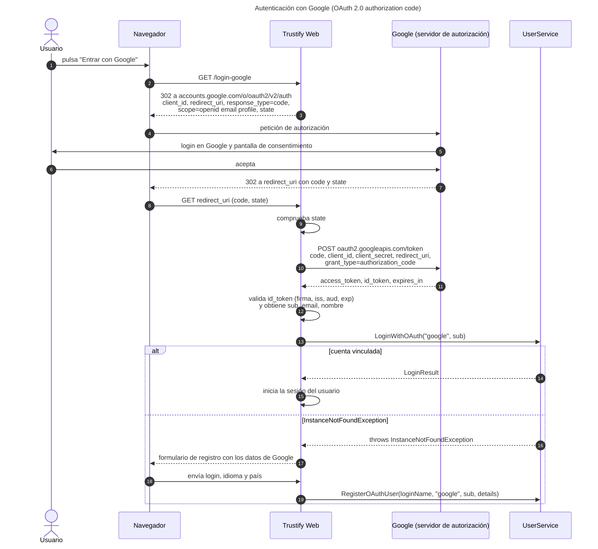

1. **Redirección.** Cuando el usuario elige "Entrar con Google", la aplicación redirige el navegador al endpoint de autorización de Google con su `client_id` (obtenido al registrar la aplicación en Google Cloud Console), la `redirect_uri` registrada, `response_type=code`, los permisos solicitados (`scope=openid email profile`) y un valor aleatorio `state`, que se guarda en la sesión para evitar ataques CSRF.
2. **Autenticación y consentimiento.** El usuario introduce sus credenciales **en Google**, nunca en nuestra aplicación, y acepta compartir su identidad y su correo con Trustify.
3. **Código de autorización.** Google redirige el navegador a la `redirect_uri` con un `code` de un solo uso y corta duración y el mismo `state`. La aplicación comprueba que `state` coincide con el guardado.
4. **Intercambio del código por tokens.** El servidor de Trustify, directamente y sin pasar por el navegador, envía a `https://oauth2.googleapis.com/token` el `code` junto con `client_id`, `client_secret`, `redirect_uri` y `grant_type=authorization_code`. Google responde con un `access_token` (permite llamar a las APIs de Google en nombre del usuario, por ejemplo al endpoint *userinfo*), un `id_token` y su caducidad (`expires_in`). Si se pidiera acceso *offline* devolvería también un `refresh_token` para renovar el `access_token`; para iniciar sesión no lo necesitamos. Como el `client_secret` solo lo conoce el servidor, interceptar el `code` no permite a un atacante obtener los tokens.
5. **Validación del `id_token`.** El `id_token` es un JWT firmado por Google con la identidad del usuario. Antes de usarlo se comprueba su firma con las claves públicas de Google, que el emisor (`iss`) es `accounts.google.com`, que el destinatario (`aud`) es nuestro `client_id` y que no ha caducado (`exp`).
6. **Identificación del usuario.** Del `id_token` tomamos el campo `sub`, el identificador único y estable del usuario en Google, y lo usamos como `providerUserId` (el correo no sirve porque el usuario lo puede cambiar). Con él se llama a `LoginWithOAuth("google", sub)`: si existe la cuenta vinculada se inicia la sesión; si lanza `InstanceNotFoundException`, se muestra un formulario de registro precargado con el nombre, apellidos y correo del `id_token` para que el usuario elija su login, idioma y país, y se llama a `RegisterOAuthUser`.

**Reparto por iteraciones.** En la iteración 1 están implementados y probados la tabla `OAuthAccount`, su entidad y DAO y las operaciones `RegisterOAuthUser` y `LoginWithOAuth` de `UserService`. En la iteración 2 implementaremos en la capa web los pasos 1 a 6: la redirección a Google, la página de retorno (`redirect_uri`), el intercambio del código por los tokens, la validación del `id_token` y el formulario de registro. Para ejecutarlo será necesario registrar la aplicación en Google Cloud Console y configurar el `client_id`, el `client_secret` y la `redirect_uri` en `Web.config`.

---

## 5. Compilación e instalación de la aplicación

<!-- [ ] Qué pide: cómo compilar e instalar, lo más sencillo posible, suponiendo un
entorno ya configurado (BD y servidor instalados).
Ideas: scripts SqlServerCreateDatabase.sql y SqlServerCreateTables.sql, compilar
MAD-Template.sln, cadena de conexión en Web.config, ejecutar los tests en x64. -->

Suponemos un entorno con Visual Studio (2019 o posterior, con .NET Framework 4.8) y SQL Server o SQL Server Express LocalDB instalados.

1. **Crear la base de datos de la aplicación.** Ejecutar `Model\SQL\SqlServerCreateDatabase.sql` (crea la BD `Trustify`; antes hay que ajustar la variable `@Default_DB_Path` a una carpeta que exista) y después `Model\SQL\SqlServerCreateTables.sql`, que crea las tablas e inserta los datos iniciales (categorías, dos vendedores y productos de ejemplo). Se pueden ejecutar desde SQL Server Management Studio o con `sqlcmd -S localhost\sqlexpress -E -I -i <script>`.
2. **Crear la base de datos de pruebas.** Ejecutar `Test\Scripts\SqlServerCreateTables.Test.sql`, que crea la BD `Trustify_test` y sus tablas (sin datos), ajustando también `@Default_DB_Path`.
3. **Revisar la cadena de conexión.** Tanto `Web\Web.config` (BD `Trustify`) como `Test\App.config` (BD `Trustify_test`) definen la cadena `TrustifyEntities`, configurada para `localhost\sqlexpress` con seguridad integrada. Si se usa otro servidor solo hay que cambiar el `data source` de esa cadena.
4. **Compilar.** Abrir `MAD-Template.sln` y compilar la solución (*Compilar > Compilar solución*). Los paquetes NuGet (Entity Framework 6, Ninject y sus extensiones, Enterprise Library) se restauran automáticamente y `ModelUtil.dll` se referencia desde la carpeta `Lib`.
5. **Ejecutar las pruebas.** Ejecutar todas las pruebas desde el Explorador de pruebas de Visual Studio.
6. **Ejecutar la aplicación web** (iteración 2). Establecer `Web` como proyecto de inicio y ejecutarlo con IIS Express.

---

## 6. Problemas conocidos

<!-- [ ] Lista de errores conocidos del código. -->

En el estado actual (final de la iteración 1) no conocemos errores en los casos de uso implementados. Al revisar el código hemos detectado los siguientes aspectos pendientes:

- `Web\HTTP\Util\IoC\IoCManagerNinject.cs` solo registra `IUserProfileDao`, `IOAuthAccountDao`, `IUserService` y el `DbContext`. Faltan los *bindings* de los DAOs y servicios de categorías, productos, valoraciones, comentarios, denuncias y etiquetas (en `Test\TestManager.cs` sí están), y hay que añadirlos al desarrollar la capa web en la iteración 2.
- `RatingService.AddRating` comprueba que existe el producto pero no que exista el usuario que valora (`raterId`). Con un identificador de usuario inexistente fallaría la clave ajena al guardar y se propagaría una excepción de Entity Framework en lugar de `InstanceNotFoundException`. En la web no ocurre, porque `raterId` es siempre el usuario autenticado.
- En los operadores `==` generados por la plantilla T4, si el primer operando es `null` y el segundo no, se llama a `Equals` sobre `null` y se lanza `NullReferenceException`. En nuestro código no se compara de esa forma.
